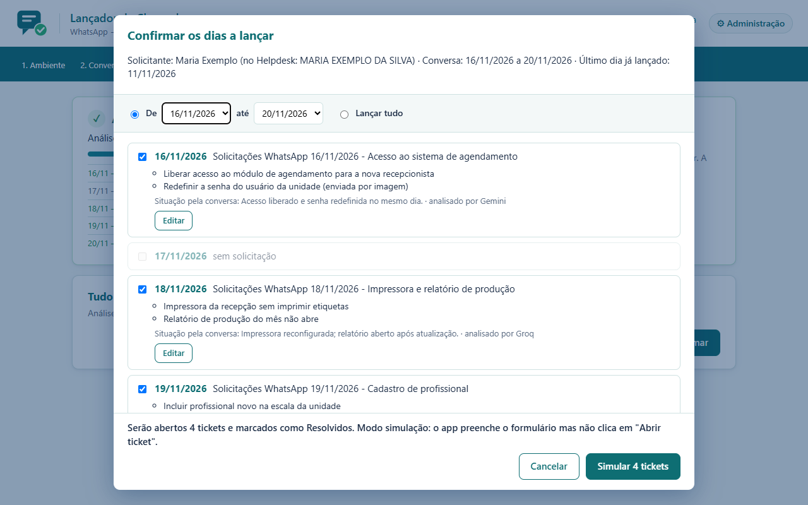
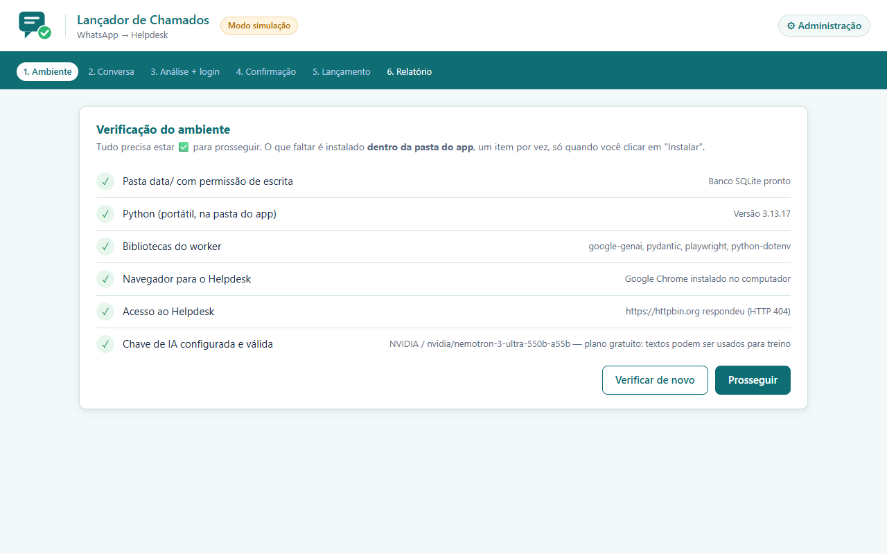
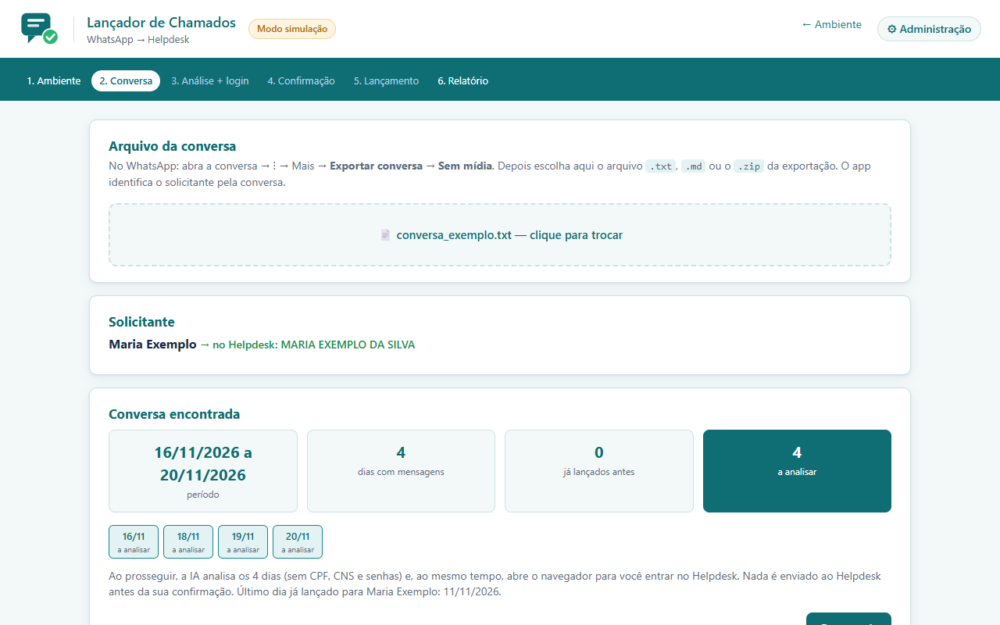
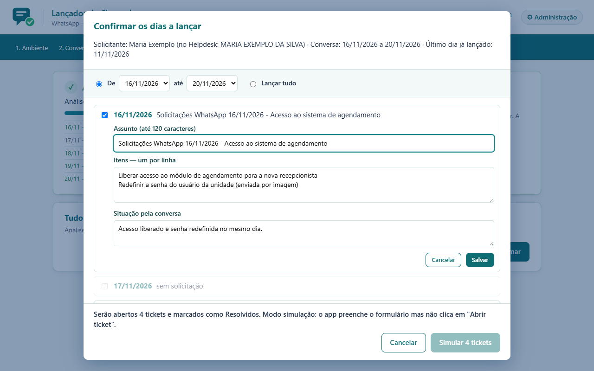
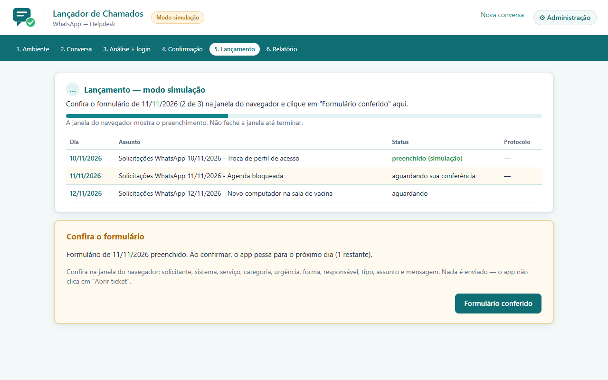
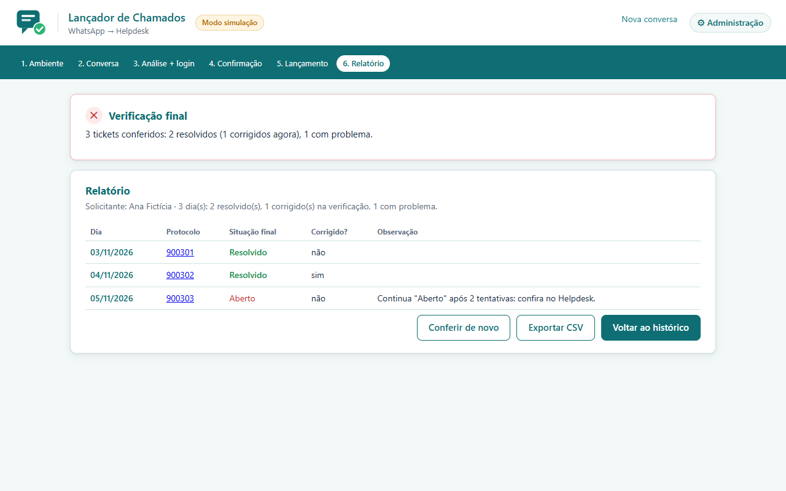
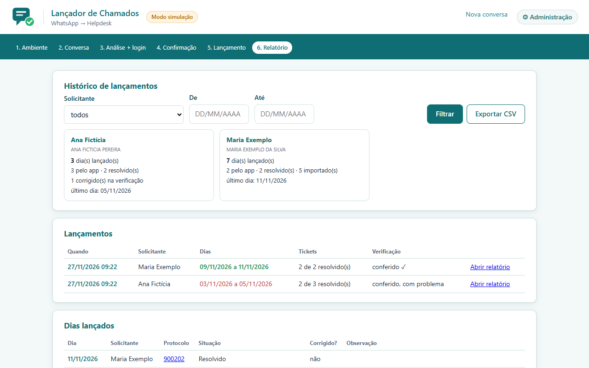
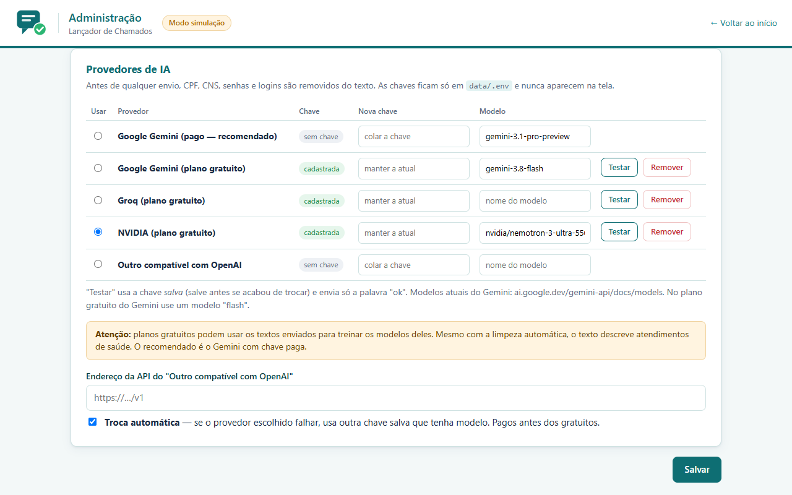
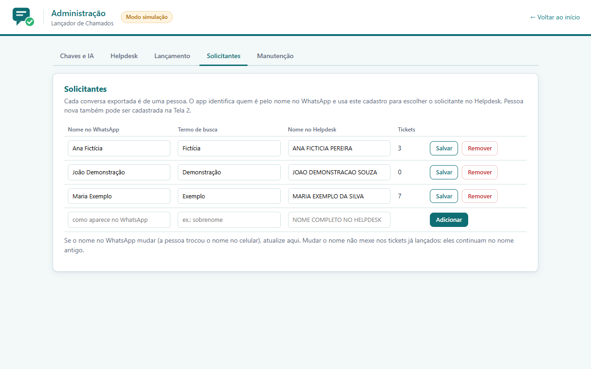
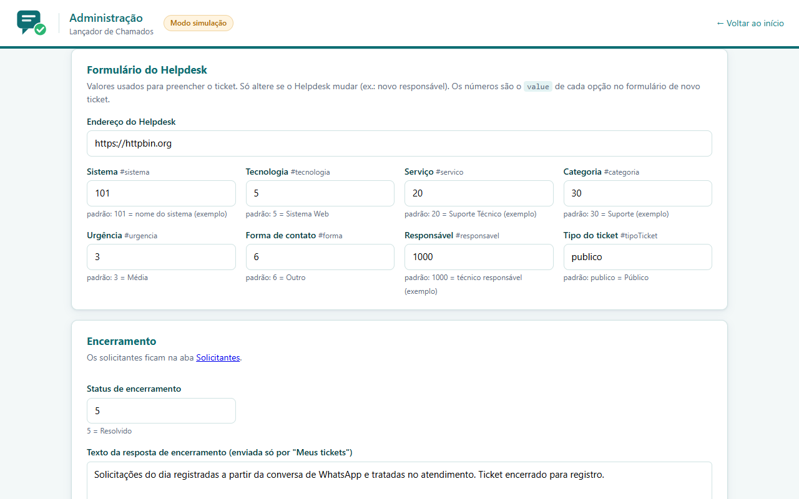

# Lançador de Chamados — WhatsApp → Helpdesk

> App desktop para Windows que lê a conversa exportada do WhatsApp, usa IA para resumir **os pedidos de cada dia**
> e abre **um ticket por dia** no Helpdesk, já marcado como **Resolvido**. No fim, confere ticket por ticket.
>
> Projeto feito em **vibe coding**: as regras de negócio e as decisões são de um coordenador de TI, e o código foi
> escrito pelo **Claude Code** (Anthropic), em conversa, com testes no sistema real a cada etapa.



---

## O problema

Na equipe de TI, boa parte do suporte chega pelo **WhatsApp**: "o sistema não abre", "libera o acesso da
recepcionista nova", "a impressora parou". O atendimento acontece na conversa, mas **não vira registro no Helpdesk**.
Registrar depois, à mão, um ticket por pedido, consome horas e quase nunca é feito.

## A solução

1. A pessoa exporta a conversa do WhatsApp (`.txt`, `.md` ou `.zip`, "sem mídia").
2. O app separa as mensagens **por dia** e identifica **quem é o solicitante**.
3. Uma IA resume os pedidos de cada dia: assunto, itens e situação. Antes de qualquer envio, o app **retira CPF,
   CNS, senhas e logins** do texto.
4. Ao mesmo tempo, abre o Helpdesk numa janela de navegador para a pessoa **fazer o login ela mesma**. O app nunca
   digita senha.
5. Um pop-up mostra a prévia de cada dia. Dá para escolher o intervalo, tirar dias e **editar** o texto. **Nada vai
   para o Helpdesk antes do clique de confirmação.**
6. O app preenche o formulário de novo ticket **pela interface**, como uma pessoa faria, abre o ticket e o marca
   como Resolvido.
7. **Verificação final:** reabre cada ticket e, se algum não ficou Resolvido, tenta de novo e registra no relatório.

## Telas

| | |
|---|---|
| **1. Verificação do ambiente**: confere Python, bibliotecas, navegador, chave da IA e acesso ao Helpdesk. O que faltar é instalado *dentro da pasta do app*, com um clique por item. |  |
| **2. Conversa**: período encontrado, dias já lançados antes e o solicitante identificado. Uma pessoa nova é cadastrada ali mesmo. |  |
| **3–4. Confirmação e edição**: a prévia que a IA extraiu de cada dia, editável antes de lançar. |  |
| **5. Lançamento (modo simulação)**: preenche o formulário, **não envia** e espera a pessoa conferir. |  |
| **6. Verificação final e relatório**: situação de cada ticket, o que foi corrigido e exportação em CSV. |  |
| **Histórico**: filtro por solicitante e período, com um cartão-resumo por pessoa. |  |
| **Administração**: chaves e modelos de IA (as chaves nunca aparecem na tela)… |  |
| …cadastro de solicitantes… |  |
| …e os valores fixos do formulário do Helpdesk. |  |

> Todas as telas usam **dados fictícios** ("Maria Exemplo", protocolos 900xxx e um endereço de teste no lugar do
> Helpdesk).

---

## Regras que o projeto não quebra

Estas regras foram definidas **antes** da primeira linha de código e guiaram todas as decisões:

- **Nada é enviado ao Helpdesk antes da confirmação** da pessoa. O servidor confere tudo de novo no clique.
- **O código nunca digita senha.** O login é feito pela pessoa, numa janela visível; a sessão fica num perfil de
  navegador do próprio app.
- **LGPD:** CPF, CNS, senhas e logins são retirados **antes** de ir para a IA, e também não vão para os tickets nem
  para os logs. O texto da conversa não fica gravado: só metadados (nome do arquivo, hash, datas).
- **Sem duplicidade:** cada par (dia, solicitante) vira no máximo um ticket. Se o app não tem certeza de que o
  ticket foi criado, marca o dia como "incerto" para nunca abrir de novo.
- **Só pela interface:** nenhum endpoint interno ou não documentado do Helpdesk. A automação fica isolada numa classe
  (`HelpdeskUI`), para virar `HelpdeskAPI` quando houver uma API oficial.
- **Modo simulação** e **trava de 1 dia**: o primeiro lançamento real só aceita um dia, para conferir no Helpdesk
  antes de liberar intervalos maiores.
- **Nada instalado no Windows sem um clique:** Python portátil, bibliotecas e navegador ficam dentro da pasta do
  app, e cada instalação fica registrada em log.

## Arquitetura

```
PHP Desktop (Chromium embutido + PHP 8.3)
 ├─ www/        telas (HTML/CSS/JS simples) e endpoints JSON em www/api/
 ├─ app/        PHP fora do www: bootstrap, schema SQLite, leitura da conversa, instalador
 ├─ worker/     Python 3.13 + Playwright: análise com IA, login, lançamento e verificação
 │   ├─ worker.py    linha de comando (checar | testar | analisar | login | lancar | verificar)
 │   ├─ nucleo.py    leitura da conversa, limpeza LGPD, prompt e schema (pydantic)
 │   └─ helpdesk.py  automação do Helpdesk pela interface (HelpdeskUI)
 ├─ runtime/    Python portátil e navegador (criados pelo botão "Instalar")
 └─ data/       app.db (SQLite), config.json, .env (chaves) — nunca versionados
```

- **Por que um worker separado:** o PHP do PHP Desktop responde a requisições curtas, e análise e lançamento
  demoram minutos. O PHP dispara o worker em segundo plano, o worker grava o progresso no SQLite e a tela consulta a
  cada 1,5 s.
- **IA com mais de um provedor:** Gemini (SDK oficial) ou qualquer API compatível com a da OpenAI (Groq, NVIDIA…).
  A saída é sempre validada por um schema pydantic. Com a **troca automática**, se um provedor falha, o app usa outra
  chave salva: pagas antes das gratuitas, com nova tentativa com espera em 429/503. A tela avisa que **planos
  gratuitos podem usar os textos para treinar modelos**.
- **Leitura da conversa com as mesmas regras em PHP e em Python:** formatos Android e iPhone, `.md`, dia/mês com 1
  dígito, AM/PM e ordem mês/dia **detectada pelo próprio arquivo**.
- **Escolha do solicitante no Helpdesk por semelhança:** o app digita o termo de busca, lê todas as opções e clica na
  mais parecida. A comparação ignora maiúsculas, acentos (inclusive gravados de forma decomposta) e "(org.)". O dia é
  recusado em caso de empate ou de nenhuma opção acima de 0,80, e o app confere a escolha depois do clique.

Tamanho (código, sem dependências): 27 arquivos PHP (~2.400 linhas), 3 Python (~1.260), 6 JS (~850), 1 CSS e 1 SQL.

---

## Como foi feito — vibe coding com o Claude Code

O trabalho foi uma conversa longa, em português, entre o coordenador de TI e o Claude Code, ao longo de alguns
dias. O que funcionou:

1. **Um `CLAUDE.md` antes do código**, com objetivo, fluxo de telas, regras invioláveis, o que já se sabia do
   Helpdesk (seletores testados num protótipo em Python) e critérios de aceite. Cada decisão nova virava um item
   numerado nesse arquivo, que se tornou a memória do projeto.
2. **Esqueleto primeiro:** PHP Desktop abrindo a Tela 1, SQLite criado e worker `checar` funcionando. Depois, uma
   tela por vez.
3. **Simulação antes do real:** o lançamento foi escrito em modo simulação. O primeiro envio real foi de **um dia**,
   conferido no Helpdesk.
4. **Testes com dados inventados, sem tocar no sistema real:** cada mudança era testada num servidor local de teste,
   com um navegador sem janela (Playwright) e conversas fictícias, antes de o usuário testar de verdade.
5. **O usuário testa, a IA observa:** nos testes reais, o Claude Code acompanhava o banco SQLite em tempo real e
   corrigia o erro no mesmo ciclo.

### Problemas reais que só apareceram no uso (e como foram resolvidos)

| O que aconteceu | Causa | Correção |
|---|---|---|
| A simulação passou rápido demais para conferir os campos | O formulário era preenchido e fechado em segundos | Na simulação, o app espera o clique em **"Formulário conferido"** |
| O botão novo não aparecia depois da atualização | O navegador embutido usava o JS antigo do cache | Todo arquivo de `assets/` ganhou `?v=<data de modificação>` |
| As datas apareciam como 11/26/2026 | O navegador embutido roda em inglês (en-US) e o `<input type="date">` segue o idioma | Seletores e campos de texto em DD/MM/AAAA |
| A exportação do iPhone não era reconhecida | Formato `[10/21/26, 11:16:30 AM]` em ordem mês/dia | A ordem é detectada pelo próprio arquivo, e AM/PM vira 24 h |
| "Solicitante não apareceu na busca" | Cadastro com "Regulação" e Helpdesk com "REGULAÇÃO" | Comparação por semelhança, sem acento nem maiúsculas |
| Erro de tempo esgotado depois de escolher o solicitante | Depois do clique, o Helpdesk **troca o campo de busca** pelo nome escolhido | A conferência procura o nome no formulário, sem esperar o campo |
| Vários solicitantes | A primeira versão assumia uma pessoa só | Uma conversa = uma pessoa, e um ticket por pessoa por dia. Os dados antigos foram migrados com backup |

### Lições

- **As regras escritas primeiro** (LGPD, nada enviado sem confirmação, sem senha no código) evitaram retrabalho e
  serviram de critério em toda dúvida.
- **Fato / estimativa / não sei:** o assistente foi orientado a separar o que verificou do que supôs, e a dar uma
  nota de confiança nas respostas técnicas. Isso deixou claro **o que ainda precisava de teste real**.
- **A interface de um sistema de terceiros muda sem aviso.** Toda ação no Helpdesk confere o resultado e, na dúvida,
  **para e avisa** em vez de seguir.
- **Vibe coding não dispensa testes:** cada funcionalidade foi testada pela IA com dados fictícios e depois pelo
  usuário no sistema real.

---

## Instalar a partir deste repositório

> O app foi feito para um Helpdesk específico: os seletores do formulário estão em `worker/helpdesk.py`. Para outro
> sistema, ajuste esses seletores e os valores em **Administração → Helpdesk**.

1. Baixe o **[PHP Desktop](https://github.com/cztomczak/phpdesktop)** (edição Chrome) e extraia numa pasta curta,
   por exemplo `C:\LancadorChamados`. Este projeto foi feito e testado com PHP 8.3 (extensões `pdo_sqlite`, `sqlite3`,
   `curl`, `openssl`, `mbstring`, `fileinfo`, `zip` e `com_dotnet`). Confira o `php.ini` que vier no pacote.
2. Copie por cima as pastas `app/`, `worker/`, `www/` e o `settings.json` deste repositório. A pasta `www/` do
   PHP Desktop é substituída.
3. Abra o `phpdesktop-chrome.exe` (ou copie o `Abrir Lancador.bat` para a mesma pasta e use-o como atalho). A **Tela 1** oferece **"Instalar"** para o Python portátil, as bibliotecas e,
   se não houver Google Chrome, o navegador do Playwright. Tudo fica dentro da pasta.
4. Em **⚙ Administração**:
   - **Chaves e IA:** cole uma chave de IA;
   - **Helpdesk:** informe o endereço e os valores do formulário;
   - **Solicitantes:** cadastre as pessoas.
5. Teste com o **modo simulação ligado** (é o padrão) antes de lançar de verdade.

Requisitos: Windows 10/11, internet e, de preferência, Google Chrome instalado.

## Aviso

Este repositório **não contém** dados reais: nenhum banco, chave, conversa, nome de pessoa, protocolo, identidade
visual de fornecedor ou da instituição onde o app é usado. Os valores do formulário em `app/bootstrap.php`
(`CONFIG_PADRAO`) são **exemplos**.

## Licença

[MIT](LICENSE): pode usar, copiar, modificar e distribuir, inclusive em uso comercial, desde que mantenha o aviso
de copyright. O software é fornecido "como está", sem garantia.
